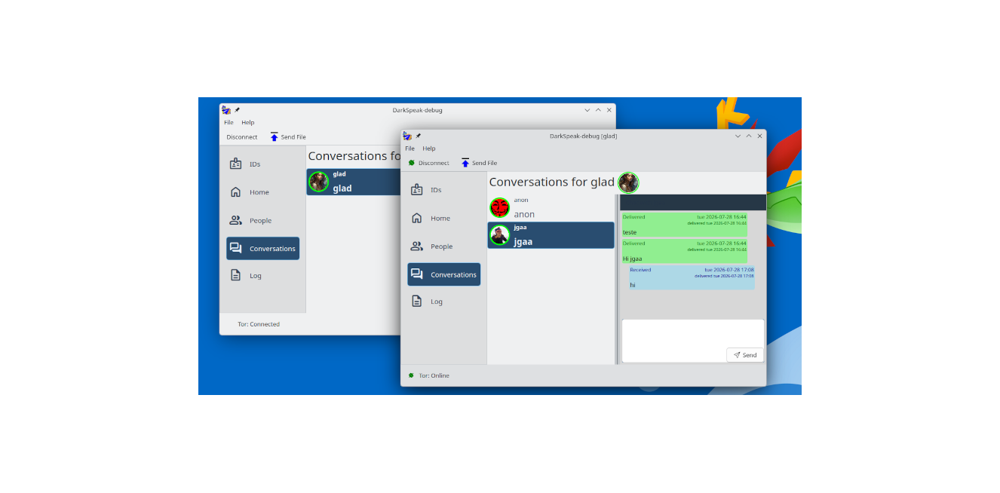

# DarkSpeak

Secure Peer to Peer Instant Messenger, using the Tor network for anonymity and best practice cryptorafic measures to provide privacy and authenticity.

Screenshots



# Mission Statement

To make a Secure and Private Communication Platform for Good People.

# Ad free

This application does not collect data about you, and it does not serve ads. It's very purpose is to prevent greedy and hostile entities to dig into your conversations and social network for manipulation, profit & greed.

# Secure and anonymous

All communication is encrypted using Public Key Cryptography (PKS) at the endpoints. Not even the Tor proxy-servers sees the content of any message or even the signaling. There are no central servers and no company-run services. That mean's that there are no-one to subpoena to get even the metadata regarding any conversation. The only traces left of any communications are the TCP connections in the Tor network.

Each peer run it's own Tor Hidden Service. This means that DarkSpeak will work as long as Tor works at any given time and place in the world. If a government feels threatened by Free Speech (and it seems like most of them do), there is still no way they can shut you down. There are no domain-names to block or take over and no IP addresses to block. If Tor works, you are free to talk with whoever you want.

# Alternative networks

The protocol used by DarkSpeak does not depend on Tor. It is designed so that it can be used by alternative networks in the future, or even directly over TCP (if no anonymity is required). At the moment however, only Tor is used.

# Building: system dependencies

The native Linux build requires a C++20 compiler, CMake 3.24+, Git, pkg-config,
libsodium, SQLite 3 and libsecret. Qt **6.10 or newer** is required, including
Core, Gui, Widgets, Network, DBus, Sql, Svg, Qml, Quick, QuickControls2,
LinguistTools, Protobuf and Test (QuickTest for the UI tests). The Qt Protobuf
module and its generator tools are required even when MCP is disabled; the
system `protoc` compiler alone does not provide Qt Protobuf.

The commands below assume your repositories provide a sufficiently recent Qt.
For example, Ubuntu 26.04 provides Qt 6.10; stock Ubuntu 24.04 and Debian 13
have older Qt versions. On older distributions, use a complete matching Qt 6.10+
SDK and point CMake at it with `-DCMAKE_PREFIX_PATH=/path/to/Qt/6.x/gcc_64`.
Keep all Qt libraries, QML plugins and generator tools from that same Qt version.

## Debian / Ubuntu

```sh
sudo apt update
sudo apt install build-essential cmake ninja-build git ca-certificates pkg-config \
    libsodium-dev libsqlite3-dev libsecret-1-dev libgl-dev protobuf-compiler \
    qt6-base-dev qt6-declarative-dev qt6-svg-dev qt6-tools-dev qt6-l10n-tools \
    qt6-grpc-dev qt6-grpc-tools

# Runtime plugins for a system-Qt build:
sudo apt install libqt6sql6-sqlite qt6-svg-plugins \
    qml6-module-qtcore qml6-module-qtqml qml6-module-qtqml-models \
    qml6-module-qtqml-workerscript qml6-module-qtquick qml6-module-qtquick-window \
    qml6-module-qtquick-controls qml6-module-qtquick-templates \
    qml6-module-qtquick-dialogs qml6-module-qtquick-layouts qml6-module-qtquick-effects
```

Qt Protobuf is packaged in
[`qt6-grpc-dev`](https://packages.ubuntu.com/resolute/qt6-grpc-dev), despite the
package's gRPC name. Ubuntu's Qt packages above require the Universe repository.

## openSUSE / SUSE

Use Tumbleweed or a SUSE release/repository supplying Qt 6.10+.

```sh
sudo zypper install gcc-c++ cmake ninja git ca-certificates pkgconf-pkg-config \
    libsodium-devel sqlite3-devel libsecret-devel protobuf protobuf-devel \
    qt6-core-devel qt6-gui-devel qt6-widgets-devel qt6-network-devel \
    qt6-dbus-devel qt6-sql-devel qt6-test-devel qt6-svg-devel \
    qt6-qml-devel qt6-quick-devel qt6-quickcontrols2-devel qt6-quickdialogs2-devel \
    qt6-linguist-devel qt6-protobuf-devel qt6-declarative-imports qt6-sql-sqlite
```

SUSE splits Qt into individual development and import packages; the names above
follow the [Tumbleweed package repository](https://download.opensuse.org/tumbleweed/repo/oss/x86_64/).

## Arch Linux

```sh
sudo pacman -Syu --needed base-devel cmake ninja git ca-certificates pkgconf \
    libsodium sqlite libsecret protobuf qt6-base qt6-declarative qt6-svg \
    qt6-tools qt6-grpc
```

Arch's [`qt6-grpc`](https://archlinux.org/packages/extra/x86_64/qt6-grpc/)
provides Qt Protobuf and its tools. Qt development files and QML plugins are
included in the corresponding Qt packages.

## Fedora

```sh
sudo dnf install gcc-c++ cmake ninja-build git ca-certificates pkgconf-pkg-config \
    libsodium-devel sqlite-devel libsecret-devel protobuf-compiler \
    qt6-qtbase-devel qt6-qtdeclarative-devel qt6-qtsvg-devel \
    qt6-qttools-devel qt6-linguist qt6-qtgrpc-devel
```

Qt Protobuf development files come from
[`qt6-qtgrpc-devel`](https://packages.fedoraproject.org/pkgs/qt6-qtgrpc/qt6-qtgrpc-devel/).
The Qt SQLite driver is included in Fedora's
[`qt6-qtbase`](https://packages.fedoraproject.org/pkgs/qt6-qtbase/qt6-qtbase/) package.

## Optional MCP and KDE integration

`-DDARKSPEAK_WITH_MCP=ON` also requires **Boost 1.81+** (program_options,
coroutine, context, chrono, json and url), OpenSSL and zlib development files.
These are system dependencies of the CMake-fetched yahat library:

```sh
# Debian / Ubuntu
sudo apt install libboost-program-options-dev libboost-coroutine-dev \
    libboost-context-dev libboost-chrono-dev libboost-json-dev libboost-url-dev \
    libssl-dev zlib1g-dev

# openSUSE / SUSE
sudo zypper install libboost_program_options-devel libboost_coroutine-devel \
    libboost_context-devel libboost_chrono-devel libboost_json-devel \
    libboost_url-devel libopenssl-devel zlib-devel

# Arch Linux
sudo pacman -S --needed boost openssl zlib

# Fedora
sudo dnf install boost-devel openssl-devel zlib-devel
```

KDE native colors optionally use KF6 ColorScheme 6.6+ development files. CMake
auto-detects this integration; `-DDARKSPEAK_KDE_COLOR_SCHEME=OFF` selects the Qt
fallback. DarkSpeak disables SafeKeeping's optional KWallet backend, so KWallet
development files are not required. A running Secret Service provider, such as
GNOME Keyring or KeePassXC with Secret Service enabled, supplies the Linux system
credential vault at runtime.

## Dependencies supplied by CMake, runtime tools and tests

CMake downloads SafeKeeping, Nayuki's QR-Code-generator and, when not installed,
QCoro. logfault is available from the bundled source, with a CMake fallback.
Enabling MCP additionally downloads yahat; enabling `DARKSPEAK_WITH_TEST_MCP`
downloads the pinned Chutney test harness. Their system-library requirements are
covered above; these fetched libraries do not need separate distro packages.
Initial configuration needs network access unless their sources are supplied
through CMake's offline source overrides.

Tor is a runtime program, and video previews use the `ffmpeg` executable rather
than FFmpeg development libraries. Install `tor` and `ffmpeg` with your package
manager (`ffmpeg-free` on Fedora). The full test runner also needs `tor-gencert`
(normally supplied by the Tor package), Python 3.12+ with pip/venv support, and
FFmpeg. On Debian/Ubuntu install `python3-venv`; on Fedora install `python3-pip`
if absent. The runner installs the pinned Python requirements in its own virtual
environment. See [tests/README.md](tests/README.md) for the complete test workflow.

# Running DarkSpeak

DarkSpeak uses a system Tor process by default. Under Linux, it expect tor to be installed. It can use the system's instance, or 
run it's own tor process with it's own configuration. This is the simpler option if you *just want it to work*.

## Ubuntu/Debian Tor setup

Install and start Tor:

You only need to enabel it if you want DarkSpeak to use the systems instance. If you want to use the "embedded" mode, it just need the tor binart to be available. 

```sh
sudo apt update
sudo apt install tor
sudo systemctl enable --now tor
```

### To use the systems tor instance

Edit `/etc/tor/torrc` and enable cookie-authenticated control access:

```ini
ControlPort 9051
CookieAuthentication 1
CookieAuthFileGroupReadable 1
```

Restart Tor and allow the current user to read the control cookie:

```sh
sudo adduser "$USER" debian-tor
sudo systemctl restart tor
```

Log out and back in (or run `newgrp debian-tor`) so the new group membership
takes effect. Do not enable an unauthenticated control port.

Verify that Tor is listening before starting DarkSpeak:

```sh
ss -ltn | grep -E ':(9050|9051)\b'
```

DarkSpeak should subsequently report `CONNECTED` and `ONLINE` in its log. If
the control port is configured differently, change the Tor settings in the
application accordingly. See [the detailed Tor configuration notes](doc/torconfig.md)
for more information.

## Isolated profiles and logging

*This is mainly for testing. You can have several identities using the default instance.*

Use a separate profile directory when running multiple DarkSpeak instances on
the same machine. Each profile gets its own settings, database, data, and
download directory:

```sh
darkspeak --profile "$HOME/.local/share/darkspeak-test-1"
darkspeak --profile "$HOME/.local/share/darkspeak-test-2"
```

The command-line logging options are:

```text
--log-file <path>
--log-level <trace|debug|info|warn|error>
```

# History

This project began in April 2016, when I wanted to chat with my friends without Facebook, Google, NSA or anyone else overseeing our conversations. The idea that private conversations are no longer possible, and that we just have to accept that, provokes me. So I used the, now dead, "Tor Chat" project as a starting-point for a protocol, and wrote my own client in C++, using QT and QML for GUI.

However, because the legacy Tor Chat client was bundling an obsolete Tor server, my program was unable to maintain reliable connections with actual "Tor Chat" users. So at some point I decided to learn from my experience with the original implementation and write a new one from scratch.

The [original implementation](https://github.com/jgaa/darkspeak/tree/original-impl-torchat-prot) is still available.

---
# Current status

One thing that has always been important to me is privacy. It was a core value handed down to me by my father. In today’s society, there are very few opportunities to have private conversations using any kind of technology. All telecom protocols and most messaging providers are required by law (or pressured by governments) to give authorities full access to listen in on any conversations they care about.

Even for peer-to-peer encrypted apps, they still require access to metadata, like who is communicating with whom, and when. There are many problems with this, ranging from the philosophical *“Why is the government terrified of its citizens having private conversations?”*, to the technical, where hackers gain access to these tap points to eavesdrop and extract data.

One known example is the so-called [“Salt Typhoon”](https://en.wikipedia.org/wiki/Salt_Typhoon) campaign, first detected in mid-2024, in which Chinese state-linked hackers apparently targeted the very network elements U.S. and allied governments use to conduct lawful intercepts (the “backdoors” mandated for wiretapping) across multiple telecom operators.

There is also a constant push from *Democracies In Name Only*, like the UK, various EU countries, and the US, to install similar tap points in all online encrypted peer-to-peer communication. Similar efforts, often using *"protecting the children"* as an excuse, aim to mandate identifiable online identities across all kinds of social media. (We just have to look at Gaza, and the poverty in their own streets, to see how much those governments *really* care about children.)

Privacy and free speech, including **anonymous free speech**, is an **absolute requirement for a functioning democracy**.

In 2020, I thought hard about this project. I was working intensely for a startup and had less time than I usually do for side projects. I was also fearful of being targeted by Europol (a police force that already has far too much power), or by some intelligence agency, simply for making an app that makes strong privacy even possible. We all know how easy it is for governments to make anyone’s life far from joyful.

**July 2026**: Resumed working on the project.

# Links

- [DarkSpeak official website](https://darkspeak.org/)
